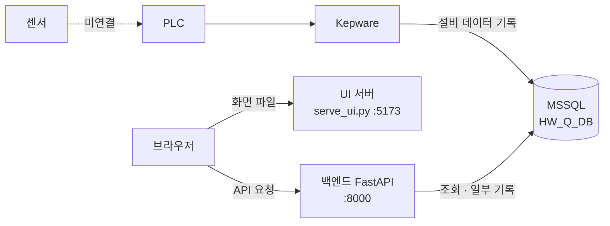

<picture>
  <source media="(prefers-color-scheme: dark)" srcset="docs/assets/banner-dark.svg">
  
</picture>

# AJIN HW 품질관리시스템

용접·비전 품질 데이터를 한곳에서 추적합니다.

용접·비전 공정의 LOT, 용접 결과, 센서 값, 비전 검사, 알람, 기준정보를 조회하고 관리하는 사내 웹 시스템입니다. 데이터는 사내 MSSQL 데이터베이스 `HW_Q_DB`에 저장되며, 설비 데이터는 PLC → Kepware → DB 경로로 들어옵니다.

**빠른 이동**: [빠른 시작](#빠른-시작) · [문서 안내](#문서-안내) · [시스템 구성](#시스템-구성과-처리-흐름) · [알려진 문제](#알려진-문제와-제약) · [담당과 기준 버전](#담당-및-문서-기준-버전)

> [!IMPORTANT]
> **현재 상태 (V1.1, 2026-11-09)**: PLC ↔ Kepware 연결과 Kepware → DB 전송은 구현되었고, **센서 ↔ PLC 연결이 남아 있습니다.** 센서부터 화면까지의 값은 아직 검증되지 않았으므로 화면의 공정 값과 알람을 현재 설비 상태로 판단하지 마세요. 현재는 실행 PC 1대에서만 접속할 수 있습니다(`127.0.0.1`).

---

## 시스템 목적과 범위

용접 공정의 기준정보를 관리하고, LOT·용접·센서·비전 검사 결과와 알람 이력을 조회하며, 알람 조치를 기록합니다. 사용자는 현장 운영자(OPERATOR), 관리자(MANAGER), 시스템 관리자(ADMIN)입니다.

| 구분 | 이 시스템이 하는 일 | 이 시스템이 하지 않는 일 (담당) |
|---|---|---|
| 데이터 수집 | 없음 (DB를 읽음) | 설비 데이터를 DB에 기록 (Kepware, 설비 담당) |
| 조회·출력 | 대시보드, 용접·비전·Lot·알람 조회, PDF·Excel·CSV 출력 | 설비 제어, PLC 프로그램 (설비 담당) |
| 기록 | 로그인 이력, 기준정보 등록·수정, 알람 확인·조치 | LOT·용접·센서·비전·알람의 발생 기록 (Kepware) |
| DB·인프라 | 테이블 읽기·쓰기 | 스키마 변경, 백업·복원 (DB 담당) · 서버, 네트워크 (전산팀) |

전체 책임 범위는 [인수인계 현황 1-1](docs/handover.md)에 있습니다.

## 주요 기능

| 화면 | 기능 | 사용 역할 |
|---|---|---|
| 대시보드 | 생산량, 합격률, 사이클 타임, 생산·불량 추이, 불량 유형 분포, 최근 알람 | 모든 역할 |
| 용접 현황 | 파트별 센서 값 그래프·표, 레시피 기준(UCL·LCL) 이탈, 최근 용접 알람 (최대 7일) | 모든 역할 |
| 비전 검사 현황 | 검사 결과·이미지, 불량 유형 분포, 카메라 상태 (최대 31일) | 모든 역할 |
| Lot 조회 | LOT별 용접·비전 판정과 상세 값 (최대 31일) | 모든 역할 |
| 알람 이력 조회 | 알람 목록·상세·표준 조치 가이드, 확인, 조치 등록 (최대 31일) | 모든 역할 |
| 기준정보 관리 | 라인, 공정, 설비, 용접부위, 파라미터, 레시피 등록·수정 | ADMIN |

용접·비전·Lot·알람 화면은 PDF·Excel·CSV로 내려받을 수 있습니다. 화면별 사용법은 [사용자 설명서](docs/user-guide.md)에 있습니다.

## 시스템 구성과 처리 흐름



| 구간 | 상태 | 담당 |
|---|---|---|
| 센서 ↔ PLC | 미연결 (남은 연동 작업) | 설비 담당 |
| PLC ↔ Kepware | 연결 완료 | 설비 담당 |
| Kepware → DB | 전송 구현 완료 · 센서 연결 후 값 검증 필요 | 설비 담당 |
| 브라우저 ↔ 백엔드 ↔ DB | 동작 확인 | 프로젝트 담당 |

| 쓰는 주체 | 기록하는 테이블 |
|---|---|
| Kepware | `t_lot`, `t_loading_event`, `t_weld_event`, `t_sensor_reading`, `t_vision_inspection`, `t_vision_inspection_detail`, `t_vision_image`, `t_alarm_event`(발생) |
| 백엔드 | `m_user`·`t_user_login_history`(로그인), 기준정보 `m_` 테이블 7개(ADMIN), `t_alarm_event`(확인·해결)·`t_alarm_action`(조치) |
| 관리자 (SQL) | `m_user` 발급·변경, `m_product`, `m_weld_machine`, `m_machine_spec` |

로그인하지 않으면 업무 API는 401을 반환합니다. 요청 흐름과 코드 위치, 판정·알람 규칙은 [개발 가이드](docs/development.md)에 있습니다.

<details>
<summary>저장소 구조</summary>

```text
.
├─ backend/                 API 서버 (main.py 진입점, routers/ 화면별 API)
├─ frontend/                화면 (index.html 진입점, js/, css/)
├─ docs/                    인수인계 문서
│  ├─ setup.md              설치·실행 가이드
│  ├─ user-guide.md         사용자 설명서
│  ├─ development.md        개발 가이드
│  ├─ operations.md         운영·장애 대응 가이드
│  ├─ release.md            변경·배포·롤백
│  ├─ handover.md           인수인계 현황
│  ├─ legacy-code-readme.md 이전 코드 설명서 (보관용)
│  └─ assets/               README 배너 이미지
├─ serve_ui.py              화면 서버 (:5173)
├─ requirements.txt         Python 패키지 목록
├─ .env.example             .env 견본 (개발 기준, 그대로 쓰지 말 것)
└─ README.md                문서 허브 (이 문서)
```

저장소에 없는 것: `.env`, `data/.secret`, `.venv`, `mssql_query.sql`(DB 담당 보관). 파일별 역할은 [개발 가이드 5장](docs/development.md)에 있습니다.

</details>

## 빠른 시작

Windows 10 이상의 PowerShell 기준입니다. 상세 절차와 오류 대응은 [설치·실행 가이드](docs/setup.md)를 보세요.

### 준비

| 항목 | 요구 사항 |
|---|---|
| Python | 3.10 이상 (`py --version`) |
| ODBC 드라이버 | ODBC Driver 18 for SQL Server |
| 네트워크 | 사내망 또는 VPN으로 DB 서버 포트 접근 |
| 미리 받을 정보 | DB 서버 주소·포트(전산팀), DB 접속 계정(DB 담당, `sa` 아님), 앱 로그인 계정(시스템 관리자) |

DB 계정·비밀번호·서버 주소는 담당자에게 별도 경로로 받으며, 저장소·문서·메신저에 적지 않습니다.

### 1. 설치 (처음 한 번)

```powershell
cd "<app 폴더의 실제 경로>"
py -m venv .venv
.\.venv\Scripts\Activate.ps1
python -m pip install -r requirements.txt
```

`Activate.ps1`에서 "스크립트 실행이 비활성화되어 있습니다" 오류가 나면 `Set-ExecutionPolicy -Scope CurrentUser RemoteSigned`를 한 번 실행한 뒤 다시 켭니다. 창을 새로 열 때마다 가상환경을 다시 켜야 합니다.

### 2. `.env` 작성

> [!CAUTION]
> **`.env.example`을 그대로 복사하지 마세요.** 개발 기준 견본이라 `DB_BACKEND=sqlite`, `sa`, 테스트 DB 이름, 값 뒤 주석이 들어 있습니다. 또한 **`DB_BACKEND` 줄이 없으면 오류 없이 SQLite(개발용) 모드로 켜집니다.** 아래 형식으로 직접 작성하고, 값 뒤에 주석·따옴표·공백을 넣지 마세요.

```powershell
New-Item -Path .env -ItemType File
notepad .env
```

```ini
DB_BACKEND=mssql
MSSQL_SERVER=<서버IP>,<포트>
MSSQL_DATABASE=HW_Q_DB
MSSQL_USER=<DB접속계정>
MSSQL_PASSWORD=<DB접속비밀번호>
MSSQL_DRIVER=ODBC Driver 18 for SQL Server
MSSQL_TRUST_CERT=<전산팀 안내값>
```

한글이 깨질 때만 `MSSQL_CHAR_ENCODING=cp949`를 추가합니다. 탐색기에서 만들면 `.env.txt`로 저장될 수 있으니 위 명령을 사용하세요.

### 3. 실행 (PowerShell 창 2개, 모두 `(.venv)` 상태)

```powershell
# 창 1: 백엔드
python -m uvicorn backend.main:app --host 127.0.0.1 --port 8000
```

```powershell
# 창 2: 화면
python serve_ui.py
```

### 4. 실행 확인 (매번)

| 순서 | 확인 | 정상 결과 |
|---|---|---|
| 1 | `http://127.0.0.1:8000/health` | `{"status": "ok", "backend": "mssql"}` |
| 2 | `http://127.0.0.1:5173` | 로그인 화면 |
| 3 | 앱 계정으로 로그인 | 대시보드 표시 |

**`/health`에 `"backend": "sqlite"`가 보이면 실 DB가 아닌 개발용 모드입니다.** `.env`의 `DB_BACKEND=mssql`을 확인하고 백엔드를 다시 실행하세요. 종료는 각 창에서 `Ctrl + C`입니다.

## 문서 안내

| 대상 | 문서 | 주요 내용 |
|---|---|---|
| 설치·실행 담당 | [설치·실행 가이드](docs/setup.md) | 준비, 설치, `.env` 작성 규칙, 실행 확인 |
| 화면 사용자 | [사용자 설명서](docs/user-guide.md) | 용어 풀이, 화면 안내, 기준정보 관리 |
| 개발자 | [개발 가이드](docs/development.md) | 구성과 데이터 흐름, 코드 구조, 임시 코드 목록, **핵심 업무 규칙**, 테스트·검증 |
| 운영자 | [운영·장애 대응 가이드](docs/operations.md) | 운영 구조와 서버 전환, 설비 연동, DB·운영 데이터 변경, 계정, 보안, 백업, **장애 대응 순서(17-3)**, 문제 해결 |
| 배포 담당 | [변경·배포·롤백](docs/release.md) | 운영 반영 경로, 승인 흐름, **되돌리기(19-3)**, 버전 표기 규칙 |
| 인수자·인계자 | [인수인계 현황](docs/handover.md) | 기준 버전, 책임 범위, 알려진 문제, 남은 과제, 체크리스트, 담당, 변경 이력 |
| 참고 (보관용) | [이전 코드 설명서](docs/legacy-code-readme.md) | 개발 단계 SQLite·Codespaces 기록. 운영 기준 아님 |

문서마다 내용이 다르면 **`docs/` 인수인계 문서를 우선**합니다. 데이터베이스 칼럼 정의, API 목록, 화면×테이블 매트릭스는 저장소 밖의 상세 설명서(PPT)에 있습니다([인수인계 현황 24-2](docs/handover.md)).

### 장 번호 안내

문서 본문은 하나의 장 번호 체계를 씁니다. 본문에서 "18-3", "12장"처럼 언급하면 아래 표로 위치를 찾으세요.

| 장 | 문서 |
|---|---|
| 0, 1, 21~25 | [인수인계 현황](docs/handover.md) |
| 2, 10, 11 | [사용자 설명서](docs/user-guide.md) |
| 3, 5, 12, 18 | [개발 가이드](docs/development.md) |
| 4, 13~17, 20 | [운영·장애 대응 가이드](docs/operations.md) |
| 6~9 | [설치·실행 가이드](docs/setup.md) |
| 19 | [변경·배포·롤백](docs/release.md) |

## 알려진 문제와 제약

주요 항목만 요약했습니다. 전체 14건(K-1~K-14)과 임시 조치는 [인수인계 현황 21장](docs/handover.md), 남은 과제는 22장에 있습니다.

| ID | 내용 | 영향 |
|---|---|---|
| - | 센서 ↔ PLC 미연결, 센서부터 화면까지 값 미검증 | 공정 값·알람을 실제 설비 상태로 판단 불가 |
| K-1 | `t_alarm_event.resolved_time`을 설비 해제와 조치 완료 두 의미로 쓸 수 있음 | Kepware가 기록하면 조치 없이 "해결됨" 표시, MTTR 왜곡 |
| K-2 | `DB_BACKEND`가 없으면 SQLite로 조용히 동작 | 실 DB가 아닌 상태로 실행될 수 있음 (매번 `/health` 확인) |
| K-4 | 알람 조치 등록에 역할 검사 없음, 조회 전용 역할 없음 | 로그인한 누구나 조치 등록 가능 |
| K-6 | DB 쿼리 시간 제한 없음 | DB 응답 지연 시 화면이 멈출 수 있음 |
| K-7 | `127.0.0.1` 전용, 운영 주소 CORS 미등록, HTTPS 미적용 | 다른 PC 접속 불가, 서버 전환 시 변경 필요 ([운영 가이드 4-3](docs/operations.md)) |
| - | 자동 테스트 없음, 운영 DB에서 수동 검증 | 수정 후 [개발 가이드 18장](docs/development.md) 체크리스트로 확인 |

## 담당 및 문서 기준 버전

| 항목 | 내용 |
|---|---|
| 문서 버전 | V1.1 (2026-11-02) |
| 대상 브랜치 · 커밋 | `<브랜치 이름 기입>` · `<커밋 해시 기입>` (`git rev-parse --short HEAD`) |
| 화면 표기 버전 | `AJIN QMS v1.1.0` (`frontend/js/components/sidebar.js`) |
| DB 스키마 기준 | `mssql_query.sql` v1.1 (테이블 23, FK 36, 인덱스 7) · DB 담당 보관 |
| 운영 반영 상태 | 실행 PC 1대 로컬 실행 · 서버 운영 전 |

| 역할 | 담당 |
|---|---|
| 코드 책임자 (인수인계자) | 진민수 |
| 코드 책임자 (인수자) | `<기입>` |
| 운영 담당 | `<기입>` |
| DB 담당 | `<기입>` |
| 전산팀 | `<기입>` |
| 설비 담당 (PLC, Kepware, 센서) | `<기입>` |

연락처는 이 문서에 적지 않고 사내 연락망으로 전달합니다. 담당별 업무와 변경 이력은 [인수인계 현황 24·25장](docs/handover.md)에 있습니다.
