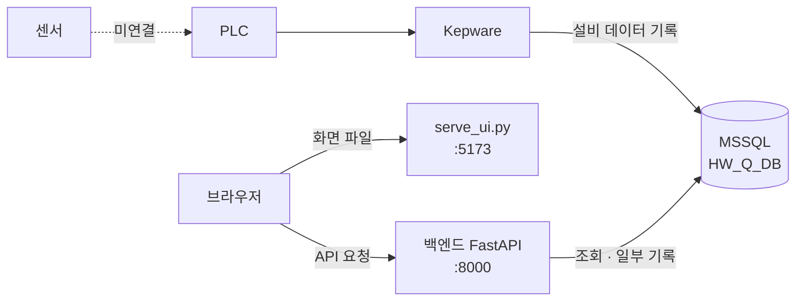

<picture>
  <source media="(prefers-color-scheme: dark)" srcset="docs/assets/banner-dark.svg">
  
</picture>

# AJIN HW 품질관리시스템

용접·비전 품질 데이터 조회·관리

이 저장소를 **Windows PC에 내려받아 설치하고 실행하는 방법**과 **코드 구조**를 설명합니다. 시스템 설명, DB 구조, 접속 정보와 계정은 인수인계 PPT에 있습니다.

**빠른 이동**: [설치와 실행](#설치와-실행) · [다음부터 실행할 때](#다음부터-실행할-때) · [문제 해결](#문제-해결) · [코드 구조](#코드-구조)

> [!IMPORTANT]
> DB 서버 주소, DB 계정·비밀번호, 앱 로그인 계정은 **이 저장소에 없습니다.** 인수인계 PPT를 보고 직접 입력합니다. 입력한 값은 저장소·메신저·메일에 올리지 마세요.

### PPT에서 볼 곳

| 필요한 정보 | 사용하는 단계 | 참고 자료 |
|---|---|---|
| DB 서버 주소·포트, DB 접속 계정·비밀번호, 인증서 옵션 | [6단계 `.env` 만들기](#6단계-env-만들기) | `detail-p12, 13` |
| 앱 로그인 계정 | [8단계 실행 확인](#8단계-실행-확인) | `detail-p13` |
| 시스템 구성, 화면 설명 | 참고 | `AJIN_HW_Q_sys_sum` |
| DB 테이블·칼럼 설명 | 참고 | `AJIN_HW_Q_sys_detail-p21~39` |

---

## 설치와 실행

처음 설치할 때 1단계부터 8단계까지 순서대로 진행합니다. 모든 명령은 **PowerShell**에서 실행합니다.

### 0단계. 준비물 확인

| 항목 | 요구 사항 | 확인 명령 | 정상 결과 |
|---|---|---|---|
| 운영체제 | Windows 10 이상 | - | - |
| Python | 3.10 이상, 설치 시 **"Add python.exe to PATH" 체크** | `py --version` | `Python 3.10` 이상 |
| ODBC 드라이버 | ODBC Driver 18 for SQL Server (Microsoft 공식 사이트) | `Get-OdbcDriver -Name "ODBC Driver 18 for SQL Server"` | 드라이버 정보가 출력됨 |
| Git | 선택 (없으면 1단계에서 ZIP으로 받기) | `git --version` | 버전이 출력됨 |
| 네트워크 | 사내망 또는 VPN으로 DB 서버에 접근 가능 | - | 전산팀 확인 |

ODBC 확인 명령에서 아무것도 나오지 않으면 드라이버가 없는 것입니다. 드라이버를 설치한 뒤 PowerShell을 다시 여세요.

### 1단계. 소스 받기

**Git이 있을 때**

```powershell
cd $HOME\Desktop
git clone https://github.com/ms63-v0/AJIN-Handover-Code.git
```

바탕화면에 `AJIN-Handover-Code` 폴더가 생깁니다.

**Git이 없을 때**

1. **Code → Download ZIP**을 누릅니다.
2. 압축을 풉니다. 폴더 이름은 `AJIN-Handover-Code-main`이 됩니다.

받은 폴더 안에 `backend`, `frontend`, `requirements.txt`, `serve_ui.py`가 바로 보이면 맞습니다. 이 폴더를 이하 **프로젝트 폴더**라고 부릅니다.

### 2단계. 프로젝트 폴더에서 PowerShell 열기

```powershell
cd "$HOME\Desktop\AJIN-Handover-Code"
```

ZIP으로 받았다면 실제 압축을 푼 경로로 바꿉니다. 탐색기에서 프로젝트 폴더를 연 뒤 주소창에 `powershell`을 입력하고 Enter를 눌러도 그 위치에서 열립니다.

확인:

```powershell
Get-ChildItem
```

`backend`, `frontend`, `requirements.txt`, `serve_ui.py`가 목록에 보여야 합니다.

### 3단계. 가상환경 만들고 켜기

```powershell
py -m venv .venv
.\.venv\Scripts\Activate.ps1
```

프롬프트 맨 앞에 `(.venv)`가 보이면 성공입니다.

**"스크립트 실행이 비활성화되어 있습니다" 오류가 나면** 아래를 한 번 실행한 뒤 `Activate.ps1`을 다시 실행합니다. 현재 사용자에게만 적용됩니다.

```powershell
Set-ExecutionPolicy -Scope CurrentUser RemoteSigned
```

**PowerShell 창을 새로 열 때마다 `.\.venv\Scripts\Activate.ps1`을 다시 실행해야 합니다.** `(.venv)`가 없는 상태에서 4·7단계를 하면 패키지가 엉뚱한 곳에 설치되거나 실행이 실패합니다.

### 4단계. 패키지 설치

```powershell
python -m pip install -r requirements.txt
```

설치 확인:

```powershell
python -c "import fastapi, uvicorn, pyodbc, openpyxl, reportlab, PIL; print('OK')"
```

`OK`가 출력되면 성공입니다.

### 5단계. `data` 폴더 만들기

```powershell
New-Item -ItemType Directory -Force -Path data
```

> [!IMPORTANT]
> **이 단계를 빠뜨리면 로그인할 때 오류가 납니다.** 로그인 서명 키(`data/.secret`)는 처음 로그인할 때 자동으로 만들어지지만, 프로그램이 `data` 폴더를 만들지는 않습니다. `data` 폴더는 저장소에 올리지 않으므로(`.gitignore`) 새로 받을 때마다 직접 만들어야 합니다.

### 6단계. `.env` 만들기

`.env`는 DB 접속 정보를 적는 파일입니다. **프로젝트 폴더 바로 아래**(`backend` 폴더와 같은 위치)에 둡니다.

```powershell
New-Item -Path .env -ItemType File
notepad .env
```

메모장에 아래 내용을 붙여 넣고, `<...>` 부분을 PPT의 값으로 바꾼 뒤 저장합니다.

```ini
DB_BACKEND=mssql
MSSQL_SERVER=<서버주소>,<포트>
MSSQL_DATABASE=HW_Q_DB
MSSQL_USER=<DB접속계정>
MSSQL_PASSWORD=<DB접속비밀번호>
MSSQL_DRIVER=ODBC Driver 18 for SQL Server
MSSQL_TRUST_CERT=<yes 또는 no>
```

| 항목 | 넣을 값 |
|---|---|
| `DB_BACKEND` | `mssql` 그대로 |
| `MSSQL_SERVER` | 서버 주소와 포트를 **쉼표**로 구분 (PPT) |
| `MSSQL_DATABASE` | `HW_Q_DB` 그대로 |
| `MSSQL_USER`, `MSSQL_PASSWORD` | DB 접속 계정 (PPT, `sa` 사용 금지) |
| `MSSQL_DRIVER` | `ODBC Driver 18 for SQL Server` 그대로 |
| `MSSQL_TRUST_CERT` | PPT 안내값 |
| `MSSQL_CHAR_ENCODING` | 한글이 깨질 때만 `MSSQL_CHAR_ENCODING=cp949` 한 줄 추가 |

> [!CAUTION]
> - **`DB_BACKEND=mssql` 줄이 빠지면 오류 없이 개발용(SQLite) 모드로 켜집니다.** 8단계에서 반드시 확인하세요.
> - 값 뒤에 설명(`# ...`), 따옴표, `=` 앞뒤 공백을 넣지 마세요. 설명까지 값으로 읽힙니다. 설명은 줄 맨 앞에 `#`을 붙여 따로 씁니다.
> - 탐색기에서 새 파일로 만들면 `.env.txt`로 저장되어 읽히지 않습니다. 위 명령을 사용하세요.
> - `.env`는 `.gitignore`에 등록되어 있어 저장소에 올라가지 않습니다. 압축해서 전달하거나 메신저에 붙여 넣지 마세요.

저장 후 확인 (비밀번호는 출력되지 않습니다):

```powershell
Get-Content .env | Select-String "DB_BACKEND|MSSQL_SERVER|MSSQL_DATABASE|MSSQL_USER|MSSQL_DRIVER|MSSQL_TRUST_CERT"
```

### 7단계. 실행

PowerShell 창을 **두 개** 엽니다. 두 창 모두 프로젝트 폴더로 이동한 뒤 `.\.venv\Scripts\Activate.ps1`로 `(.venv)` 상태를 만들고 실행합니다.

**창 1: 백엔드 (데이터 처리)**

```powershell
python -m uvicorn backend.main:app --host 127.0.0.1 --port 8000
```

`Uvicorn running on http://127.0.0.1:8000`이 보이면 성공입니다. 이 창은 닫지 않습니다.

**창 2: 화면 서버**

```powershell
python serve_ui.py
```

`UI 서버: http://127.0.0.1:5173`이 보이면 성공입니다. 이 창도 닫지 않습니다.

### 8단계. 실행 확인

브라우저(Chrome 또는 Edge)에서 차례로 확인합니다.

| 순서 | 주소·동작 | 정상 결과 |
|---|---|---|
| 1 | `http://127.0.0.1:8000/health` | `{"status":"ok","backend":"mssql"}` |
| 2 | `http://127.0.0.1:5173` | 로그인 화면 |
| 3 | PPT의 앱 로그인 계정으로 로그인 | 대시보드 표시 |
| 4 | 왼쪽 메뉴 6개를 차례로 누름 | 각 화면이 열림 (ADMIN 계정만 "기준정보 관리" 보임) |

> [!WARNING]
> 1번 결과에 `"backend":"sqlite"`가 보이면 **실 DB가 아닌 개발용 모드**입니다. 창 1을 `Ctrl + C`로 끄고 `.env`의 `DB_BACKEND=mssql` 줄과 파일 이름(`.env.txt`가 아닌지)을 확인한 뒤 다시 실행하세요.

화면 값이 비어 있어도 고장이 아닐 수 있습니다. 센서 ↔ PLC 연결 전이라 설비 데이터가 일부만 들어오거나 없을 수 있습니다. 조회 기간을 먼저 확인하세요.

**종료**: 각 창에서 `Ctrl + C`를 누릅니다.

---

## 앱 로그인 계정 관리

이 섹션은 **화면에 로그인하는 계정**(`m_user` 테이블)을 다룹니다. DB에 접속하는 계정(`.env`의 `MSSQL_USER`)과는 다릅니다.

> [!IMPORTANT]
> 계정 추가와 비밀번호 변경은 **DB 접속 권한이 있는 계정**(PPT의 DB 접속 계정)으로 SQL Server Management Studio(SSMS)에서 실행합니다. 비밀번호 원문과 해시 값은 채팅, 메신저, 메일, 문서에 남기지 마세요.

### 역할

| 역할 | 기준정보 관리 | 알람 확인·조치 | 조회·내보내기 |
|---|---|---|---|
| `ADMIN` | 가능 | 가능 | 가능 |
| `MANAGER` | 불가 | 가능 | 가능 |
| `OPERATOR` | 불가 | 가능 | 가능 |

알람 조치 등록은 역할과 관계없이 로그인한 누구나 할 수 있습니다. 조회 전용 역할은 아직 없습니다.

### 1. 비밀번호 해시 만들기

비밀번호는 DB에 **해시 값**으로만 저장합니다. 해시는 프로젝트 폴더에서 만듭니다.

```powershell
cd "<프로젝트 폴더>"
.\.venv\Scripts\Activate.ps1

$sec   = Read-Host "앱 로그인 비밀번호 (8자 이상)" -AsSecureString
$plain = (New-Object System.Net.NetworkCredential("", $sec)).Password
$hash  = $plain | py -c "import sys; from backend.security import hash_password; print(hash_password(sys.stdin.readline().strip()))"
Remove-Variable plain, sec

$hash
```

- 입력할 때 글자가 보이지 않는 것이 정상입니다.
- 출력된 `scrypt$`로 시작하는 한 줄을 **앞뒤 공백 없이** 복사합니다. 줄이 나뉘면 로그인이 실패합니다.
- 다 쓰면 메모리에서 지웁니다: `Remove-Variable hash`

비밀번호 규칙(8자 이상, 대문자·소문자·숫자·기호 중 3종 이상 권장)은 프로그램이 검사하지 않으므로 운영 규칙으로 지킵니다. 비밀번호는 계정을 쓸 본인이 직접 입력하는 것을 원칙으로 합니다.

### 2. 계정 추가

SSMS에서 PPT의 DB 접속 계정으로 연결하고, 대상 DB를 `HW_Q_DB`로 선택한 뒤 실행합니다. **영문 입력 상태에서** 작성하세요. 한글 상태에서 쓰면 쉼표와 따옴표가 전각으로 바뀌어 구문 오류(156)가 납니다.

```sql
USE [HW_Q_DB];
GO
IF NOT EXISTS (SELECT 1 FROM dbo.m_user WHERE login_id = N'<로그인ID>')
BEGIN
    INSERT INTO dbo.m_user
        (login_id, password_hash, user_name, role_code, department, force_change_yn, use_yn)
    VALUES
        (N'<로그인ID>', N'<1번에서 만든 해시>', N'<이름>', N'<ADMIN|MANAGER|OPERATOR>', N'<부서>', N'N', N'Y');
END
GO
SELECT login_id, role_code, use_yn FROM dbo.m_user ORDER BY user_id;
```

| 자리 | 넣을 값 |
|---|---|
| `<로그인ID>` | 영문 또는 숫자 (예: `hong.gd`) |
| `<1번에서 만든 해시>` | `scrypt$`로 시작하는 한 줄 |
| `<ADMIN\|MANAGER\|OPERATOR>` | 셋 중 하나만 |

- 같은 ID가 이미 있으면 추가되지 않습니다. 마지막 결과에 ID가 보이는지 확인하세요.
- 이 시스템은 첫 로그인 때 비밀번호 변경을 강제하지 않습니다.

### 3. 로그인 확인

`http://127.0.0.1:5173`에서 새 계정으로 로그인합니다. `ADMIN`이면 "기준정보 관리" 메뉴가 보여야 합니다.

### 4. 비밀번호 변경

1번으로 새 해시를 만든 뒤 SSMS에서 실행합니다.

```sql
UPDATE dbo.m_user
   SET password_hash = N'<새 해시>',
       password_changed_at = DATEADD(HOUR, 9, SYSUTCDATETIME()),
       updated_at = DATEADD(HOUR, 9, SYSUTCDATETIME())
 WHERE login_id = N'<로그인ID>';
```

시간 값은 반드시 `DATEADD(HOUR, 9, SYSUTCDATETIME())`로 씁니다. 한국 시간으로 저장하기 위해서입니다.

### 5. 잠금 해제

비밀번호를 5번 틀리면 10분 동안 잠깁니다. 10분이 지나면 자동으로 풀리며, 바로 풀어야 할 때만 실행합니다.

```sql
UPDATE dbo.m_user
   SET failed_login_count = 0, locked_until = NULL
 WHERE login_id = N'<로그인ID>';
```

### 6. 퇴사·전보 처리

계정을 **삭제하지 말고** 사용 중지합니다. 과거 기록이 이 계정을 참조하고 있을 수 있습니다.

```sql
UPDATE dbo.m_user
   SET use_yn = N'N', updated_at = DATEADD(HOUR, 9, SYSUTCDATETIME())
 WHERE login_id = N'<로그인ID>';
```

다시 사용하려면 `use_yn`을 `N'Y'`로 바꿉니다.

### 7. 로그인 실패 원인 확인

```sql
SELECT TOP 50 attempted_login_id, login_result, login_time
FROM dbo.t_user_login_history
ORDER BY login_time DESC;
```

| `login_result` | 뜻 | 조치 |
|---|---|---|
| `SUCCESS` | 성공 | - |
| `FAIL_NO_USER` | ID가 없거나 사용 중지 | ID 오타, 사용 여부 확인 |
| `FAIL_PW` | 비밀번호 불일치 | 비밀번호 재확인, 필요하면 4번 |
| `FAIL_LOCKED` | 5회 실패로 잠김 | 10분 대기 또는 5번 |

---

## 다음부터 실행할 때

설치(1~6단계)는 한 번만 하면 됩니다. 이후에는 아래만 반복합니다.

```powershell
# 창 1
cd "<프로젝트 폴더>"
.\.venv\Scripts\Activate.ps1
python -m uvicorn backend.main:app --host 127.0.0.1 --port 8000
```

```powershell
# 창 2
cd "<프로젝트 폴더>"
.\.venv\Scripts\Activate.ps1
python serve_ui.py
```

그다음 `http://127.0.0.1:8000/health`에서 `"backend":"mssql"`을 확인하고 `http://127.0.0.1:5173`에 접속합니다.

현재 구성은 **실행한 PC에서만 접속**할 수 있습니다(`127.0.0.1`). 다른 PC에서 접속하려면 서버 주소, 방화벽, 허용 주소 설정을 바꿔야 합니다([코드 구조 > 다른 PC에서 접속하려면](#다른-pc에서-접속하려면)).

---

## 문제 해결

| 증상 | 원인 | 해결 |
|---|---|---|
| `py`를 찾을 수 없음 | Python 미설치 또는 PATH 미등록 | Python 재설치 시 "Add python.exe to PATH" 체크 |
| `(.venv)`가 안 보임 | 가상환경을 켜지 않음 | `.\.venv\Scripts\Activate.ps1` |
| 스크립트 실행이 비활성화됨 | PowerShell 실행 정책 | `Set-ExecutionPolicy -Scope CurrentUser RemoteSigned` |
| `No module named 'fastapi'` 또는 `'pyodbc'` | 가상환경 밖에서 실행했거나 설치 누락 | `(.venv)` 상태에서 4단계 다시 실행 |
| 로그인할 때 500 오류, 창 1에 `FileNotFoundError ... data\.secret` | `data` 폴더 없음 | 5단계 실행 후 다시 로그인 |
| `.env에 다음 값이 필요합니다` | 필수 항목 누락·빈 값 | 6단계 표의 항목 확인 |
| `DB_BACKEND 값이 올바르지 않습니다` | 오타 | `DB_BACKEND=mssql` |
| `/health`에 `"backend":"sqlite"` | `DB_BACKEND` 줄 없음, `.env.txt`로 저장됨, 파일 위치가 틀림 | 6단계 확인 후 창 1 재실행 |
| `.env`를 고쳤는데 반영되지 않음 | Windows 환경변수에 같은 이름(`MSSQL_USER` 등)이 이미 있으면 그 값이 우선 | 시스템 환경변수 확인, 또는 창 1 재실행 |
| `Data source name not found` | ODBC Driver 18 미설치 | 0단계 드라이버 설치 후 PowerShell 재시작 |
| `Login failed for user` | DB 계정·비밀번호 오류 | `.env`의 `MSSQL_USER`, `MSSQL_PASSWORD`를 PPT와 대조 |
| `Cannot open database` | DB 이름 오류 | `MSSQL_DATABASE=HW_Q_DB` |
| 서버를 찾을 수 없음, 시간 초과 | 사내망·VPN 미연결, 주소·포트 오류, 방화벽 | 연결 상태와 `MSSQL_SERVER` 확인, 전산팀에 방화벽 확인 |
| 한글이 `???`로 표시 | DB 문자 인코딩 차이 | `.env`에 `MSSQL_CHAR_ENCODING=cp949` 추가 후 창 1 재실행 |
| 로그인 화면에서 401 | ID·비밀번호 불일치, 사용 중지, 5회 실패 잠금(10분) | 계정 확인, 잠금은 10분 후 자동 해제 |
| 포트 8000 또는 5173 사용 중 | 이전 실행이 남아 있음 | 이전 창을 `Ctrl + C`로 종료 후 재실행 |
| 화면이 예전 그대로 | 브라우저 캐시 | `Ctrl + F5` |
| 500 오류 또는 "서버 처리 중 오류" | 백엔드 내부 오류 | 창 1의 빨간 오류 전문과 시각을 기록해 담당자에게 전달 (비밀번호·주소는 가림) |

---

## 코드 구조

### 전체 구성



| 구성 요소 | 하는 일 |
|---|---|
| `serve_ui.py` (:5173) | `frontend/` 폴더의 화면 파일을 브라우저에 전달합니다. 데이터는 다루지 않습니다. |
| 백엔드 (:8000) | 브라우저의 API 요청을 받아 로그인을 확인하고 DB를 조회·기록합니다. |
| MSSQL `HW_Q_DB` | 기준정보(`m_` 테이블)와 실적·이력(`t_` 테이블)을 저장합니다. |
| Kepware | 설비 데이터(LOT, 용접, 센서, 비전, 알람 발생)를 DB에 기록합니다. 이 저장소의 코드가 아닙니다. |

브라우저는 화면 파일을 5173에서 받고, 데이터는 같은 주소의 8000 포트로 **직접** 요청합니다. 로그인하지 않으면 업무 API는 401을 반환합니다.

### 폴더 구조

```text
AJIN-Handover-Code/
├─ backend/                     백엔드 (Python FastAPI)
│  ├─ main.py                   진입점: 앱 생성, 라우터 등록, 허용 주소(CORS), /health
│  ├─ __init__.py               시간대를 KST로 고정
│  ├─ config.py                 업무 설정값 (로그인 정책, 조회 기간 한도, 알람 우선순위·조치 가이드)
│  ├─ db.py                     .env 읽기, DB_BACKEND에 따라 드라이버 선택
│  ├─ db_mssql.py               MSSQL 연결 (pyodbc)
│  ├─ db_sqlite.py              개발용 SQLite 연결 (운영 미사용)
│  ├─ sqldialect.py             SQLite·MSSQL 문법 차이 흡수
│  ├─ security.py               비밀번호 해시(scrypt), 로그인 쿠키 서명, 로그인 확인
│  ├─ alarms.py                 알람 유형·우선순위·상태 판단
│  ├─ common.py                 기간 계산, 파트 종합 판정, 불량 분포
│  ├─ report.py                 PDF·Excel 보고서 생성
│  ├─ vision_image.py           비전 이미지 표시 처리
│  └─ routers/                  화면별 API (아래 표)
├─ frontend/                    화면 (HTML·JavaScript, 빌드 과정 없음)
│  ├─ index.html                화면 진입점
│  ├─ css/                      디자인
│  └─ js/
│     ├─ main.js                화면 전환 (#/dashboard 등)
│     ├─ api.js                 백엔드 API 호출 함수 모음
│     ├─ config.js              API 주소, 메뉴, 갱신 주기, 센서 표시 규칙
│     ├─ exporter.js            PDF·Excel·CSV 내려받기
│     ├─ pages/                 메뉴별 화면
│     └─ components/            공통 부품 (사이드바, 헤더, 차트, 팝업, 표 등)
├─ docs/assets/                 README 배너 이미지
├─ serve_ui.py                  화면 서버
├─ requirements.txt             Python 패키지 목록
├─ mssql_query.sql              DB 테이블 생성 스크립트 (DB 담당용, 설치 시 실행하지 않음)
├─ .gitignore                   저장소 제외 목록
└─ README.md                    이 문서
```

설치 후 프로젝트 폴더에는 저장소에 없는 아래 항목이 생깁니다. 모두 `.gitignore`로 제외되어 올라가지 않습니다.

| 항목 | 만들어지는 시점 |
|---|---|
| `.venv/` | 3단계 |
| `data/` | 5단계 (`data/.secret`은 첫 로그인 때 자동 생성) |
| `.env` | 6단계 |
| `__pycache__/` | 실행할 때 자동 생성 |

### 화면과 코드 연결

| 화면 (주소) | 화면 코드 | 호출 API | 백엔드 코드 |
|---|---|---|---|
| 로그인 | `js/pages/login.js` | `/api/auth/login`, `/api/auth/me`, `/api/auth/logout` | `routers/auth.py`, `security.py` |
| 대시보드 (`#/dashboard`) | `js/pages/dashboard.js` | `GET /api/dashboard` | `routers/dashboard.py`, `common.py` |
| 용접 현황 (`#/weld`) | `js/pages/weld.js` | `GET /api/weld`, `GET /api/weld/table` | `routers/weld.py` |
| 비전 검사 현황 (`#/vision`) | `js/pages/vision.js` | `GET /api/vision`, `GET /api/vision/images/{id}` | `routers/vision.py`, `vision_image.py` |
| Lot 조회 (`#/lot`) | `js/pages/lot/` | `GET /api/lots`, `GET /api/lots/{id}`, `GET /api/live/feed` | `routers/lots.py`, `routers/live.py` |
| 알람 이력 조회 (`#/alarm`) | `js/pages/alarm/` | `GET /api/alarms`, `POST /api/alarms/{id}/ack`, `POST /api/alarms/{id}/actions` | `routers/alarm.py`, `alarms.py` |
| 기준정보 관리 (`#/admin`, ADMIN) | `js/pages/admin/` | `/api/admin/...`, `/api/lines`, `/api/machines` | `routers/admin.py`, `routers/master.py` |
| 사이드바 공정 연결 상태 | `js/components/sidebar.js` | `GET /api/status` | `routers/master.py` |
| PDF·Excel·CSV 내려받기 | `js/exporter.js` | `POST /api/export/{weld\|vision\|lot\|alarm}` | `routers/export.py`, `report.py` |

### 요청이 처리되는 순서 (예: Lot 조회)

| 순서 | 일어나는 일 | 코드 |
|---|---|---|
| 1 | 화면에서 조회 조건을 받아 요청 | `frontend/js/pages/lot/` |
| 2 | `GET http://127.0.0.1:8000/api/lots` 호출 | `frontend/js/api.js` |
| 3 | 로그인 쿠키(`qms_session`) 확인, 없으면 401 | `backend/security.py` |
| 4 | SQL 실행 | `backend/routers/lots.py` → `backend/db.py` → `backend/db_mssql.py` |
| 5 | 결과를 표와 상세 패널에 표시 | `frontend/js/pages/lot/` |

### 어디를 고치면 되나

| 바꾸고 싶은 것 | 파일 |
|---|---|
| 화면 모양·문구 | `frontend/js/pages/<화면>`, `frontend/css/` |
| 메뉴, 자동 갱신 주기, 센서 표시 이름·소수 자리 | `frontend/js/config.js` |
| 조회 조건, 집계 SQL | `backend/routers/<기능>.py` |
| 로그인 잠금·유지 시간, 조회 기간 한도, 알람 등급·조치 가이드 | `backend/config.py` |
| 알람 유형·상태 판단 | `backend/alarms.py` |
| 판정·불량 집계 | `backend/common.py` |
| 허용 주소(CORS) | `backend/main.py` |

### 주요 설정값 (`backend/config.py`, `frontend/js/config.js`)

| 항목 | 값 |
|---|---|
| 로그인 잠금 | 5회 연속 실패 시 10분 |
| 로그인 유지 | 12시간, 자동 로그인 체크 시 7일 |
| 조회 기간 한도 | 용접 7일, 비전·Lot·알람 31일 |
| 비전 "가동중" 판정 | 최근 2분 안에 검사 데이터가 있을 때 |
| 화면 자동 갱신 | Lot 실시간 피드 3초, 그 외 10초 |
| PDF·Excel 즉시 생성 한도 | 100,000행 (PDF 상세 표는 2,000행) |
| 화면 표시 센서 코드 | `WELD_CURRENT`, `WELD_PRESS`, `COOLANT_TEMP`, `WELD_TIME` |

### 알아 둘 규칙

<details>
<summary>판정·알람 규칙 (코드만 보고는 알기 어려운 부분)</summary>

**판정과 집계**

- 생산량과 합격률은 `t_lot`에서 `lot_end_time`이 조회 기간 안이고 `final_result`가 `PENDING`이 아닌 LOT으로 계산합니다.
- 파트 종합 판정은 해당 파트의 용접·비전 결과 중 하나라도 NG면 NG, 둘 다 OK면 OK입니다.
- 사이클 타임은 첫 `LOAD_COMPLETE` 시각부터 마지막 비전 검사 종료 시각까지입니다.

**알람 코드 형식** (`backend/alarms.py`)

| 유형 | 판단 기준 | `alarm_code` 형식 | 우선순위 |
|---|---|---|---|
| 비전 알람 | 알람 설비의 `machine_type`이 `VISION` | `VIS_NG` | 2 경고 |
| 기준 이탈 | `LIM_HI` / `LIM_LO`로 시작 | `LIM_HI:<파라미터코드>:<파트번호>` (예: `LIM_HI:WELD_CURRENT:2`) | 2 경고 |
| 설비 알람 | 그 외 | `A-001`, 파트 연결 시 `A-001:2` | `A-004`는 3 주의, 그 외 `A-`는 1 긴급 |

Kepware가 이 형식과 다르게 기록하면 모든 알람이 "설비 알람·경고"로 표시됩니다.

**알람 상태**

- `resolved_time`이 있으면 해결됨, 조치 기록이 있으면 조치중, 그 외는 미해결입니다.
- 확인 버튼은 확인 시각·확인자를 최초 1회만 기록합니다.
- 조치 등록은 `t_alarm_action`에 행을 추가하고 `resolved_time`을 현재 시각으로 채웁니다.
- 조치 구분·소속·사번은 전용 칼럼이 없어 `action_desc` 앞에 `[구분|소속|사번|연락처]` 형식으로 저장됩니다.

</details>

<details>
<summary>개발 단계에서 남은 코드 (운영에서 쓰지 않음)</summary>

| 위치 | 내용 | 비고 |
|---|---|---|
| `backend/db_sqlite.py`, `sqldialect.py` | 개발용 SQLite 지원 | `DB_BACKEND`가 없으면 SQLite로 동작하는 원인 |
| `POST /api/auth/reset-db` | 개발 데이터 초기화 | 실 DB에서는 차단됨 |
| `frontend/js/config.js`, `serve_ui.py` | Codespaces 개발 환경 분기 | Windows 로컬 실행에는 영향 없음 |
| `routers/vision.py`의 `sim://` 경로 | 데모용 생성 이미지 | 실제 이미지는 `data/vision_images/` 경로 |
| 사이드바 "POP DB" 표시 | 연동 확인용 | 제거 예정 |

</details>

### 다른 PC에서 접속하려면

현재는 실행 PC에서만 접속됩니다. 여러 PC에서 쓰려면 아래 세 곳을 바꿔야 합니다. 화면 코드는 접속한 주소의 8000 포트를 자동으로 찾으므로 고치지 않아도 됩니다.

| 위치 | 현재 | 바꿀 내용 |
|---|---|---|
| 창 1 실행 명령 | `--host 127.0.0.1` | 서버 주소로 받도록 변경 (전산팀과 협의) |
| `serve_ui.py` 마지막 줄 | `("127.0.0.1", 5173)` | 위와 같이 변경 |
| `backend/main.py`의 `allow_origins` | `localhost`, `127.0.0.1`만 허용 | `http://<서버 주소>:5173` 추가 |

> [!CAUTION]
> 주소를 열면 사내망의 누구나 접속할 수 있습니다. 방화벽 범위와 HTTPS 적용을 전산팀과 먼저 협의하세요.

### 코드를 고친 뒤 반영하기

1. 창 1과 창 2를 `Ctrl + C`로 끄고 7단계 명령으로 다시 실행합니다.
2. 브라우저에서 `Ctrl + F5`로 새로 고칩니다.
3. 8단계 확인 표를 다시 확인합니다.
4. `requirements.txt`를 바꿨다면 4단계를 다시 실행합니다.

빌드 과정은 없습니다. 자동 테스트도 없으므로 고친 화면을 직접 열어 확인합니다.

---

<details>
<summary>설치가 확인된 패키지 버전</summary>

정상 동작한 PC에 설치된 버전입니다. `requirements.txt`는 버전을 고정하지 않으므로, 나중에 설치할 때 버전이 달라져 문제가 생기면 이 표를 기준으로 맞춥니다.

| 패키지 | 버전 |
|---|---|
| fastapi | 0.162.0 |
| starlette | 1.10.0 |
| uvicorn | 0.54.0 |
| pydantic | 2.14.1 |
| pydantic_core | 2.50.1 |
| pyodbc | 5.3.0 |
| openpyxl | 3.1.5 |
| reportlab | 5.1.0 |
| pillow | 13.0.0 |
| anyio | 4.15.1 |

같은 버전으로 설치하는 예:

```powershell
python -m pip install fastapi==0.162.0 uvicorn==0.54.0 pyodbc==5.3.0 openpyxl==3.1.5 reportlab==5.1.0 pillow==13.0.0
```

</details>

인계 기준일: 2026-11-09 · 저장소: [ms63-v0/AJIN-Handover-Code](https://github.com/ms63-v0/AJIN-Handover-Code)
